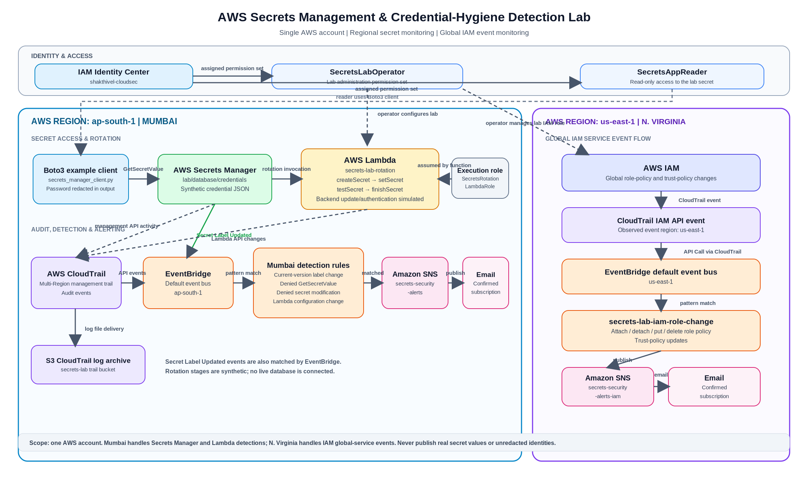
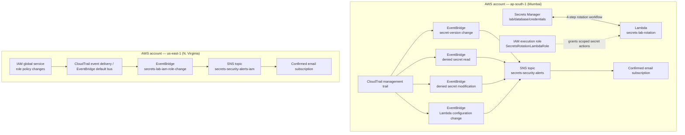

# AWS Secrets Management & Credential-Hygiene Detection Lab

A single-account AWS security engineering lab that demonstrates secure secret storage, least-privilege access, controlled secret rotation, CloudTrail auditing, and event-driven security notifications.

> **Lab scope:** This project was built and tested in one AWS account. It uses `ap-south-1` (Mumbai) for Secrets Manager, the rotation Lambda, and secret-related detections. IAM is a global service; its CloudTrail management events were observed in `us-east-1` (N. Virginia), so IAM role-change alerting is implemented there with a separate EventBridge rule and SNS topic.
>
> **Important limitation:** The rotation workflow changes the version stored in AWS Secrets Manager. Its `setSecret` and `testSecret` stages are explicitly simulated: no live database is connected, updated, or authenticated against.

## Project goals

- Demonstrate why hardcoded credentials and shared `.env` files are risky.
- Store synthetic database connection details in AWS Secrets Manager rather than in application source code.
- Apply least-privilege access for the operator and application-reader identities.
- Demonstrate manual and Lambda-orchestrated secret version rotation.
- Capture AWS management activity with CloudTrail.
- Detect secret access/changes and IAM/Lambda configuration changes with EventBridge.
- Send alerts to confirmed email subscriptions through Amazon SNS.
- Record evidence and analyze the controls using the STRIDE threat-model framework.

## Architecture


See [Architecture Documentation](docs/architecture.md).
### Regional layout



### Main data and detection flows

1. **Secret retrieval:** The application-reader identity calls `GetSecretValue` for the one lab secret. The example client reads the secret through Boto3 and redacts the password in its console output.
2. **Rotation:** Secrets Manager invokes `secrets-lab-rotation`. The handler processes `createSecret`, `setSecret`, `testSecret`, and `finishSecret`. It writes an `AWSPENDING` version and promotes it to `AWSCURRENT` after the synthetic checks pass.
3. **Audit:** CloudTrail records management API activity, including secret reads, version changes, IAM role policy changes, and Lambda configuration changes.
4. **Detection and notification:** EventBridge rules match selected CloudTrail or Secrets Manager events and publish to regional SNS topics. SNS sends email notifications to confirmed subscriptions.
5. **Global IAM event handling:** The IAM role-change rule is deployed in `us-east-1`; the project keeps a separate SNS topic in that Region rather than targeting the Mumbai SNS topic across Regions.

## AWS resources used

| Component | Resource / configuration | Region | Purpose |
|---|---|---|---|
| Secret storage | `lab/database/credentials` | `ap-south-1` | Synthetic database credential JSON stored in Secrets Manager |
| Rotation function | `secrets-lab-rotation` | `ap-south-1` | Four-step Secrets Manager rotation handler |
| Lambda execution role | `SecretsRotationLambdaRole` | Account IAM | Scoped permissions for the single lab secret |
| Operator access | IAM Identity Center permission set `SecretsLabOperator` | Account-wide | Performs lab administration through an assigned SSO identity |
| Reader access | IAM Identity Center permission set `SecretsAppReader` | Account-wide | Reads the exact lab secret; does not receive modification permissions |
| Audit trail | `secrets-lab-management-trail` | Multi-Region trail, home Region `ap-south-1` | Records management events and delivers logs to S3 |
| SNS topic | `secrets-security-alerts` | `ap-south-1` | Receives secret and Lambda-related notifications |
| SNS topic | `secrets-security-alerts-iam` | `us-east-1` | Receives IAM role-change notifications |
| IAM EventBridge rule | `secrets-lab-iam-role-change` | `us-east-1` | Detects changes to `SecretsRotationLambdaRole` |

Other Mumbai EventBridge rule names used by the lab:

- `secrets-lab-current-version-change`
- `secrets-lab-denied-secret-read`
- `secrets-lab-secret-modification`
- `secrets-lab-iam-lambda-change` (used for the Lambda-change branch; IAM global-service events are covered by the dedicated `us-east-1` rule)

Do not publish account-specific ARNs, account IDs, email addresses, secret values, or unredacted CloudTrail identities in a public repository. Replace them with placeholders in screenshots and examples.

## Repository layout

```text
.
├── .gitignore
├── actual-put-secret-value-event.json
├── denied-secret-read-pattern.json
├── iam-lambda-privilege-pattern.json
├── iam-role-change-pattern-us-east-1.json
├── lambda_function_corrected.py
├── sample-denied-secret-read-event.json
├── sample-iam-policy-change-event.json
├── sample-iam-role-change-us-east-1.json
├── sample-lambda-function-change-event.json
├── sample-secret-modification-denied-event.json
├── secret-modification-denied-pattern.json
├── docs/
│   └── audit-findings.md
├── examples/
│   ├── insecure/
│   │   ├── .env                 # Must remain ignored by Git
│   │   ├── .env.example         # Safe placeholder template
│   │   ├── env-file-shared.py
│   │   └── hardcoded_creds.py
│   └── secure/
│       ├── rotate_demo_secret.py
│       └── secrets_manager_client.py
└── terraform/                   # No Terraform files appeared in the supplied tree
```

The supplied directory listing showed an empty `terraform/` folder. The AWS infrastructure described here was configured and tested through the AWS Console and AWS CLI; this README does **not** claim that the deployed resources are currently provisioned by Terraform.

## Security design

### 1. Insecure examples and secret hygiene

The `examples/insecure/` directory demonstrates credential exposure patterns using synthetic placeholders and a local `.env` example. The `.env` file must not be committed. Keep `.env` and `**/.env` in `.gitignore`, and use `.env.example` only for non-sensitive placeholder names and values.

Before pushing to a public repository, run:

```powershell
git check-ignore -v .\examples\insecure\.env
git status --short
```

Review the output and ensure that `.env`, real credentials, `actual-put-secret-value-event.json` (if it contains real identity details), and unredacted audit exports are not staged.

### 2. Secrets Manager and application reader

The lab secret stores a JSON object with fields such as `username`, `password`, `host`, `port`, and `database`. These are synthetic values for the lab; no production credential or live database is involved.

`SecretsAppReader` is intended to allow `secretsmanager:GetSecretValue` and `secretsmanager:DescribeSecret` only on the exact lab secret ARN. It is not intended to list or modify secrets. The reader was used to demonstrate that a read-only identity receives `AccessDenied` when attempting `PutSecretValue`.

`examples/secure/secrets_manager_client.py` demonstrates retrieval with Boto3. Its output should not print the password.

### 3. Rotation workflow

The Lambda handler in `lambda_function_corrected.py` implements the Secrets Manager rotation steps:

| Step | Behavior in this lab |
|---|---|
| `createSecret` | Generates a cryptographically random synthetic password and stores an `AWSPENDING` version using the request token. |
| `setSecret` | Checks the pending JSON structure and target identity, then logs that the backend update is simulated. |
| `testSecret` | Performs local structural and consistency checks; it does not authenticate to a database. |
| `finishSecret` | Moves `AWSCURRENT` to the pending version and removes the previous current stage as part of the version-stage update. |

The handler restricts itself to the configured `SECRET_ARN`, validates expected JSON fields, avoids logging secret contents, and handles retry/idempotency states for pending versions.

**Deployment handler-name note:** The supplied local filename is `lambda_function_corrected.py`, while the deployed Lambda configuration was recorded as `lambda_function.lambda_handler`. When packaging this source for deployment, either rename/copy it to `lambda_function.py` and keep handler `lambda_function.lambda_handler`, or configure the handler to `lambda_function_corrected.lambda_handler` if that is the filename inside the deployment package.

`examples/secure/rotate_demo_secret.py` demonstrates a manual synthetic secret update. The automated rotation was successfully exercised, then automatic rotation was disabled during the final lab cleanup check. The recorded `LastRotatedDate` remained available after rotation was disabled.

### 4. CloudTrail audit

The multi-Region CloudTrail management trail records management API activity and delivers logs to an S3 bucket. The lab used CloudTrail Event History / `lookup-events` to investigate real `GetSecretValue`, `PutSecretValue`, `PutRolePolicy`, and other API events.

An important observation from the denied secret modification test: the denied CloudTrail event did not include `requestParameters.secretId`. Therefore, the denied-modification EventBridge pattern matches the relevant Secrets Manager API names and `AccessDenied` error code instead of depending on a secret ARN field that was absent in the observed event. This makes the rule broader across matching denied operations in the account and Region; review that scope before reusing it in production.

### 5. EventBridge and SNS detection

The lab uses EventBridge patterns to distinguish:

- Secret version label changes, including `AWSCURRENT` updates.
- Denied `GetSecretValue` attempts.
- Denied secret modification attempts, including `PutSecretValue` and other selected mutation APIs.
- Lambda function configuration/code/permission changes.
- IAM role policy changes to `SecretsRotationLambdaRole`, monitored in `us-east-1` because the observed IAM CloudTrail event was recorded in that Region.

SNS topics are regional. EventBridge targets use an SNS topic in the same Region as the rule. The topic access policies authorize the named EventBridge rules to call `sns:Publish`.

SNS server-side encryption was disabled on the two lab alert topics after troubleshooting delivery from EventBridge. The project therefore demonstrates event-driven email alerting, **not encrypted SNS-topic storage**. If encryption is required, configure a customer-managed KMS key and its key policy to permit the publishing service, and verify delivery before relying on it.

## Verified test evidence

The following live behaviors were observed during the lab:

| Test | Observed result |
|---|---|
| Secret-version label update | Email notification received |
| Attempted secret read with restricted reader | AWS returned `AccessDenied`; email notification received |
| Attempted `PutSecretValue` with restricted reader | AWS returned `AccessDenied`; after correcting the event pattern and SNS delivery configuration, email notification received |
| Lambda configuration description change | Email notification received; original empty description restored |
| IAM `PutRolePolicy` on `SecretsRotationLambdaRole` | Email notification received through the `us-east-1` rule/topic |
| IAM `DeleteRolePolicy` cleanup | Email notification received after the temporary test policy was deleted |

Synthetic `TestEventPattern` checks also returned `true` for the IAM and Lambda sample events. A successful `TestEventPattern` only validates event-pattern matching; the live email tests above provide the end-to-end evidence.

### Cleanup status recorded during testing

- Lambda function description restored to an empty string.
- Secrets Manager automatic rotation disabled after the successful rotation test.
- Temporary `TemporaryDetectionTestOnly` inline policy was deleted from `SecretsRotationLambdaRole`; the deletion alert was received.
- The `SecretsLabOperator` CLI identity did not have `iam:ListRolePolicies` during the final verification attempt. Confirmed deletion through the AWS Console and the deletion alert instead; do not add broad IAM permissions just for this optional read check.

## Running the local examples

Use Python 3 and AWS CLI v2. The AWS CLI profiles referenced in the lab are `secrets-lab` and `secrets-reader`; configure these locally with IAM Identity Center SSO and the appropriate permission-set assignments. Do not put access keys or real secrets in the repository.

Example SSO sign-in:

```powershell
aws sso login --profile secrets-reader
aws sso login --profile secrets-lab
```

Install local dependencies as needed:

```powershell
python -m pip install boto3 python-dotenv
```

Run the secure reader example with the reader profile configured in your environment or in the script's Boto3 session configuration:

```powershell
python .\examples\secure\secrets_manager_client.py
```

Run the manual rotation demonstration only in a disposable lab secret:

```powershell
python .\examples\secure\rotate_demo_secret.py
```

Do not run rotation or mutation examples against production secrets.

## Testing EventBridge patterns

Run these from the repository root so the `file://` paths resolve correctly. Example for the N. Virginia IAM rule:

```powershell
aws events test-event-pattern `
  --event-pattern file://iam-role-change-pattern-us-east-1.json `
  --event file://sample-iam-role-change-us-east-1.json `
  --region us-east-1 `
  --profile secrets-lab `
  --output json
```

Example for denied secret modification in Mumbai:

```powershell
aws events test-event-pattern `
  --event-pattern file://secret-modification-denied-pattern.json `
  --event file://sample-secret-modification-denied-event.json `
  --region ap-south-1 `
  --profile secrets-lab `
  --output json
```

Use synthetic sample events for pattern tests. When validating a real event, retrieve the CloudTrail record, redact identity/account details before saving or sharing it, and compare the actual event structure with the pattern. Do not treat a synthetic pattern test as proof of live delivery.

## Threat Modeling

This project uses the STRIDE threat-modeling framework
to identify and mitigate security threats.

See the [STRIDE Threat Model](docs/stride-threat-model.md).

## STRIDE threat model summary

| STRIDE category | Example threat in this lab | Main controls / evidence |
|---|---|---|
| Spoofing | Stolen SSO session or misuse of a lab identity | IAM Identity Center sign-in and scoped permission sets; use MFA in the identity provider/account configuration. |
| Tampering | Unauthorized secret write or change to a secret resource policy | Reader has no secret-write permissions; denied modification tested; CloudTrail and EventBridge alerts. |
| Repudiation | User denies having performed a secret or IAM change | CloudTrail management-event history and S3 log archive. |
| Information disclosure | Unauthorized `GetSecretValue` | Exact-secret reader scope, denied read test, email alert; password redaction in example output. |
| Denial of service | Deleting a secret, disabling rotation, or changing rotation configuration | Restrict mutation permissions and alert on selected denied/successful management API actions. |
| Elevation of privilege | Modifying the Lambda execution role or function configuration to gain broader access | Monitor `PutRolePolicy`, attach/detach policy, trust-policy, and Lambda configuration/permission changes; test IAM and Lambda alerts. |

This is a lab-level threat-model summary, not a formal certification or a claim that all threat paths are eliminated. Extend it with asset owners, likelihood/impact, residual risk, and remediation SLAs for a production design.

## Known limitations and next improvements

- **No live database integration:** Implement a real database-side credential update and authentication check before calling this production-ready rotation.
- **Single AWS account:** The lab was constrained to one account; it does not demonstrate cross-account Organizations deployment or a multi-account security boundary.
- **Terraform not implemented in the supplied tree:** Add Terraform resources and validate `plan`/`apply`/`destroy` before describing this as IaC-managed infrastructure.
- **SNS encryption disabled:** Use a customer-managed KMS key with a reviewed key policy if encrypted SNS topics are a requirement.
- **Email-only notifications:** Consider a ticketing/SIEM integration, escalation routing, alert deduplication, and retention requirements.
- **Pattern scope:** Denied modification events are matched without `secretId` because it was absent in the observed denied CloudTrail event. Validate event schemas and scope carefully before production reuse.
- **Operational hardening:** Add EventBridge DLQs/retry review, SNS delivery monitoring, CloudWatch alarms, and a documented incident response runbook.

## Cost and safety notes

AWS charges may apply for Secrets Manager secret storage and API use, Lambda invocations, CloudTrail data/log storage, S3 storage/requests, EventBridge events, SNS notifications, and any KMS keys. Review the AWS Billing console and the resources in both `ap-south-1` and `us-east-1` after testing. Delete only disposable lab resources that are no longer needed; retain evidence only after redacting sensitive values.

## Before publishing to GitHub

- [ ] Confirm `.env` is ignored: `git check-ignore -v .\examples\insecure\.env`.
- [ ] Check `git status --short` and ensure the real `.env` is not staged.
- [ ] Remove or sanitize `actual-put-secret-value-event.json` if it contains real account/identity metadata.
- [ ] Replace AWS account IDs, ARNs, email addresses, secret values, and user identity strings in screenshots and sample files with placeholders.
- [ ] Keep only synthetic sample event payloads in the public repository.
- [ ] Confirm the Lambda source filename and configured handler name agree.
- [ ] Either populate `terraform/` with tested IaC or label it clearly as planned work.
- [ ] Review `docs/audit-findings.md` and link only findings that are appropriate to publish.

## Disclaimer

This repository is an educational AWS security lab. It is not a production-ready secrets-management service, a compliance attestation, or a substitute for a formal security review. Never use real production credentials in the examples or test procedures.
