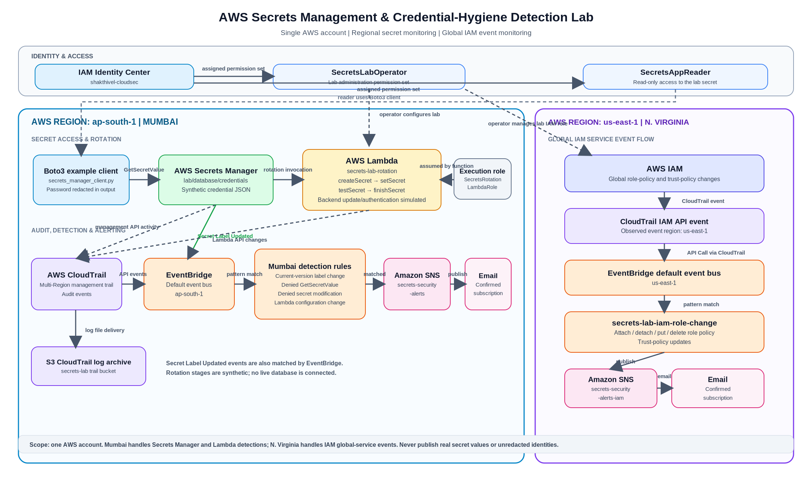

# Architecture — AWS Secrets Management & Credential-Hygiene Detection Lab

This document describes the implemented single-account lab architecture. Mumbai handles Secrets Manager and Lambda detections; N. Virginia handles IAM global-service event detection.

## Architecture files

- `architecture.png` — rendered architecture diagram embedded above and used in the project README.
- `architecture.md` — this document, describing the components, event flows, and implementation boundaries.
- `render_architecture.py` — Python renderer stored alongside this document in `docs/`. When run, it writes the diagram outputs into the same `docs/` directory. Only `architecture.png` is required by the repository documentation; any locally generated SVG is not referenced as a committed project file.

## Key flows

1. **Application retrieval:** the Boto3 example client uses the `SecretsAppReader` IAM Identity Center permission set to call `GetSecretValue` for the lab secret. The example redacts the password in its output.
2. **Rotation:** Secrets Manager invokes `secrets-lab-rotation`. The handler runs `createSecret`, `setSecret`, `testSecret`, and `finishSecret`. It creates a pending version and promotes it to the current version in Secrets Manager. The backend update and authentication stages are simulated; no database is connected.
3. **Audit:** the multi-Region CloudTrail management trail records AWS API activity and delivers audit log files to S3.
4. **Mumbai detections:** EventBridge in `ap-south-1` handles secret-version label changes, denied secret reads, denied secret modifications, and Lambda configuration changes. Matching events publish to the `secrets-security-alerts` SNS topic and its confirmed email subscription.
5. **IAM detections:** IAM is a global service. The role-policy management event tested in this lab was recorded with `awsRegion=us-east-1`. The EventBridge rule `secrets-lab-iam-role-change` in `us-east-1` matches selected changes to `SecretsRotationLambdaRole` and publishes to `secrets-security-alerts-iam` and its confirmed email subscription.

## Evidence included in the project

The `docs/screenshots/` directory contains sanitized evidence of:

- Secrets Manager secret metadata and version stages. Secret values must never be shown.
- Lambda configuration and successful rotation execution logs.
- CloudTrail records for secret access and denied secret operations.
- EventBridge rules and SNS targets in Mumbai and N. Virginia.
- SNS topics and email notifications for tested detections.

Before sharing evidence publicly, redact account identifiers, full ARNs, personal email addresses, subscription ARNs, session identifiers, and any credential values.

## Accuracy notes and scope

- This is a single-account AWS lab, not a multi-account AWS Organizations deployment.
- The rotation workflow updates the secret version in Secrets Manager. It does not connect to, update, or authenticate against a real database; the backend update and validation stages are simulated.
- The resources were configured and tested through the AWS Console and AWS CLI. A Terraform deployment is not implemented in this project.
- The IAM role-change detection rule is deployed in `us-east-1`; it is not a Mumbai EventBridge rule.
- The EventBridge rule for denied secret modifications does not filter on `secretId`, because the denied CloudTrail event observed during testing did not include that field in `requestParameters`. The rule therefore matches the selected denied Secrets Manager operations more broadly within the account and Region.
- SNS topic encryption was disabled during delivery troubleshooting. The project demonstrates EventBridge-to-SNS email notification, not encrypted SNS topic storage.
